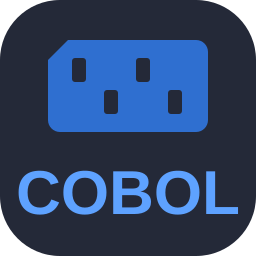
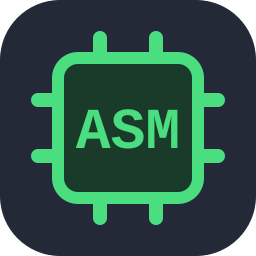

<div align="center">


<a href="https://github.com/Carlinnn">
  
</a>

<p>
  <a href="https://www.instagram.com/kakamanoel0/"></a>
  
  
</p>

</div>

## 🧑‍💻 Sobre mim

```ts
const carlos = {
  local: "Sapezal - MT, Brasil",
  foco: ["Web full stack", "APIs e sistemas", "Ferramentas para desktop"],
  lema: "Quando tudo está errado e confuso, apague tudo e recomece do zero.",
};
```

Gosto de tecnologia, de educação e de mudar a vida das pessoas através da programação.

## 🛠️ Tecnologias

<div align="center">

**Linguagens**





**Front-end e back-end**


**Bancos de dados e infra**


**Sistemas**


</div>

## 🚀 Projetos em destaque

| Projeto | Descrição | Stack |
| --- | --- | --- |
| 🎓 [**tcc-react-vue-desempenho**](https://github.com/Carlinnn/tcc-react-vue-desempenho) | TCC (IFMT, 2026): técnicas de otimização de desempenho em React e Vue.js, medidas com Lighthouse |   |
| 🗳️ [**Sistema-de-Votos-BBB**](https://github.com/Carlinnn/Sistema-de-Votos-BBB) | Votação assíncrona em alta escala com filas |    |
| 👻 [**GhostFollow**](https://github.com/Carlinnn/GhostFollow) | Web app local que mostra quem não te segue de volta no Instagram |  |
| 🔗 [**encurtaja**](https://github.com/Carlinnn/encurtaja) | Encurtador de links com contagem de cliques |  |
| 🧬 [**mygit**](https://github.com/Carlinnn/mygit) | Implementação simplificada do Git em C++ com Clean Architecture (Ports & Adapters) |  |

## 📊 Estatísticas

<div align="center">


</div>


